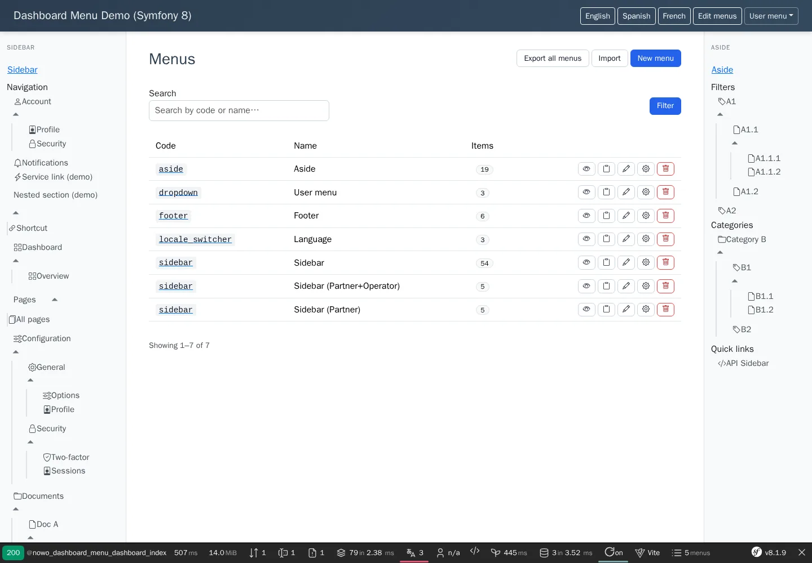
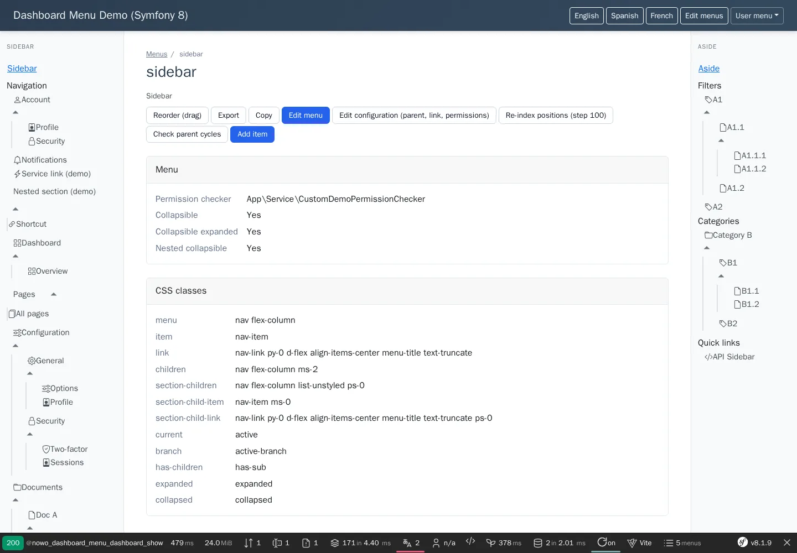
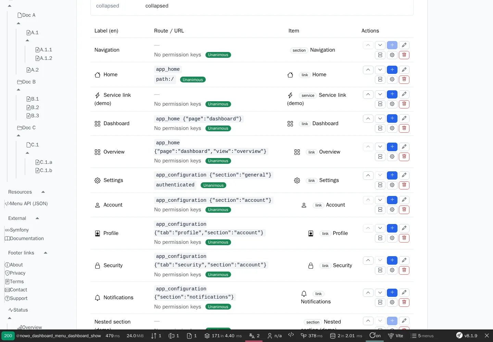
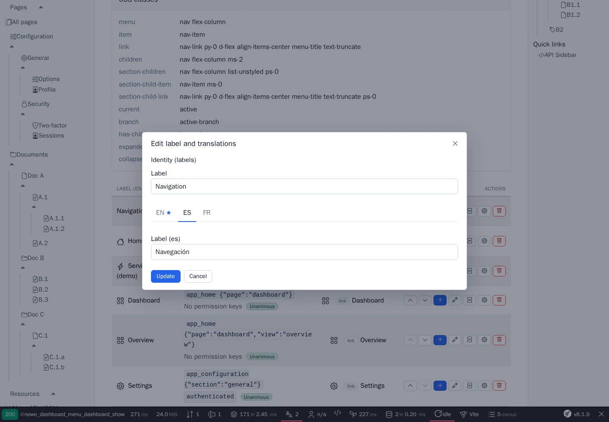
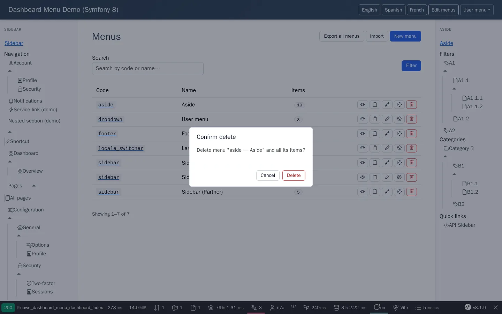
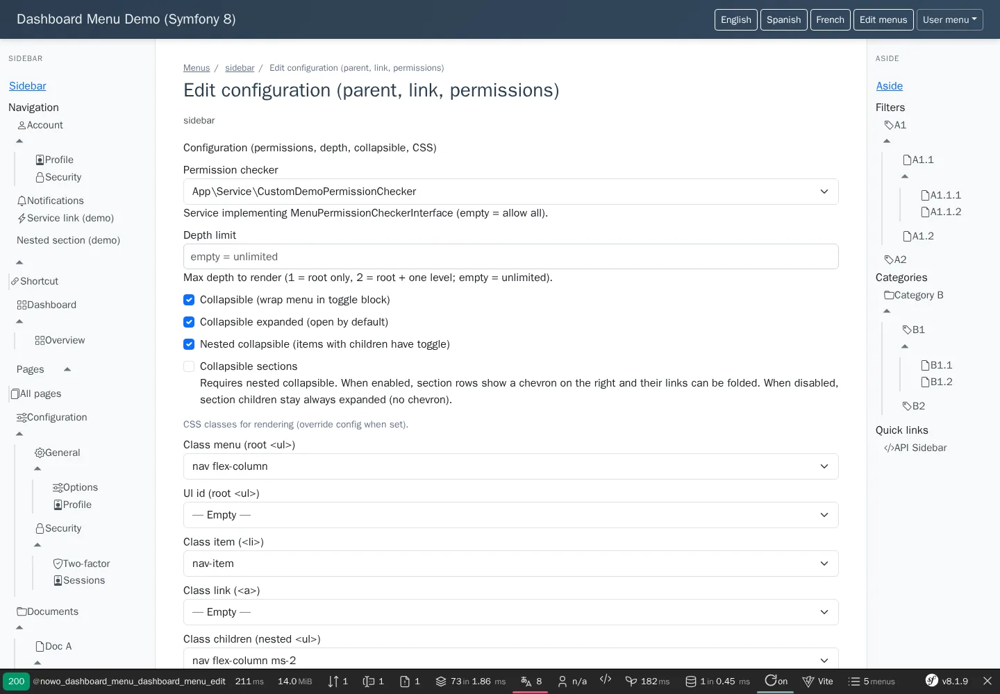
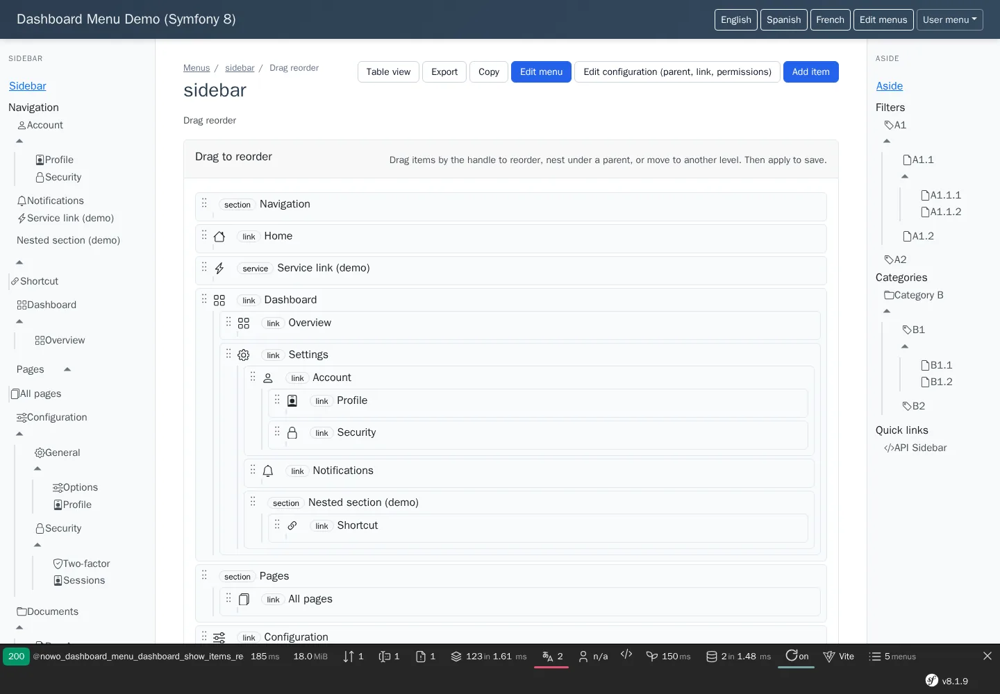

# Templates

Admin dashboard pages of DashboardMenuBundle on the UiKit 2.1 page contract (REQ-UI-003). The controller builds the
view models with `Nowo\DashboardMenuBundle\View\DashboardPages`; `Nowo\DashboardMenuBundle\View\DashboardWebUi`
resolves the per-page templates (`web_ui.templates.<page>`) and the layout (`web_ui.layout_template`, null =
`nowo_ui_kit.layouts.admin`). The templates extend a UiKit scaffold and fill data blocks only. Contract test:
`tests/Integration/PageContractTest.php` (UiKit `PageContractTestCase`).

The public menu rendering (`menu.html.twig`, `dashboard_menu_tree()`, `dashboard_menu_config()`,
`dashboard_menu_href()`) is **host chrome**, not a page: it is not part of this contract and its API is unchanged.

## Table of contents

- [Pages](#pages)
- [Dialog fragments](#dialog-fragments)
- [Unique pages](#unique-pages)
- [Per-page overrides](#per-page-overrides)
- [Shared partials](#shared-partials)
- [Allowed exceptions](#allowed-exceptions)
- [Screenshots](#screenshots)

## Pages

| Page | Template | Scaffold | View model | Data blocks filled |
| --- | --- | --- | --- | --- |
| Menus list | `dashboard/index.html.twig` | `page/list` | `ListPage` (header actions: export all (link, new tab), import (dialog), new menu (dialog, primary); columns: code (icon, link, base badge), name, items, context; rows `{menu, items}`; rowActions: items (view), copy, edit identity, edit configuration (dialogs; configuration and delete not for base menus), delete (POST, CSRF `FormView`, `Confirm` with the menu name); filters: `SearchQueryType` (`q`, `FilterField` width lg + placeholder), `filtersSubmit`, `filtersClear` while searching; `Pagination` (`dashboard.pagination`); `EmptyState` with the new-menu action; attributes `data-testid="dashboard-menu-menus"`) + `dialogs` | `nowo_ui_list_row`, `nowo_ui_modals`, `nowo_ui_styles`, `nowo_ui_scripts` |
| Menu detail | `dashboard/show.html.twig` | `page/show` | `ShowPage` (header: code, name, breadcrumbs Menus › code, actions reorder (when items), export, copy, edit menu (primary), edit configuration (not base), re-index positions + check parent cycles (POST, CSRF `FormView`, when items), add item (primary); sections: menu properties (base, context, permission checker, depth limit, collapsible flags), stored CSS classes; attributes `data-testid="dashboard-menu-show"`) + `menu`, `item_columns` (`list<Column>`), `item_rows` (`DashboardPages::itemRows()`: `item`, `depth`, `parentLabel`, `actions` = move up / down (POST), add child, edit labels, edit type / position / icon, edit configuration (dialogs), delete (POST + `Confirm`)), `add_item` (`Action`), `current_locale`, `dialogs` | `nowo_ui_show_after` → `nowo_dashboard_menu_items` (items table with the list scaffold slots, row actions through `nowo_ui_partial('row_actions')`) → `nowo_dashboard_menu_item_cells` (context `row`, `item`, `depth`); `nowo_ui_modals`, `nowo_ui_styles`, `nowo_ui_scripts` |
| New / edit menu | `dashboard/menu_form.html.twig` | `page/form` | `FormPage` (title new menu / edit menu / edit configuration, breadcrumbs, submit create / update, cancel to the menu or the list, `formThemes` = deprecated `dashboard.ui.form_themes`; attributes `data-testid="dashboard-menu-menu-form"`) + `form`, `is_edit`, `section_focus` (basic / config / null), `menu` | `nowo_ui_form_body` (definition / configuration fieldsets, `_menu_form_fields.html.twig`), `nowo_ui_styles` |
| New / edit item | `dashboard/item_form.html.twig` | `page/form` | `FormPage` (title add item / add child / edit labels / edit type, position and icon / edit configuration / edit item; cancel to the menu; attributes `data-testid="dashboard-menu-item-form"`) + `form`, `menu`, `is_edit`, `section_focus`, `locales`, `app_routes`, `item_has_children`, `show_translations`; `live: true` (configuration section with symfony/ux-live-component): `form` is a field-less shell and the Live component `dashboard_menu_item_form` renders its fields in embedded mode (`embedded: true`: no own form tag, every field bound with `data-model`), the scaffold form posts natively to the edit action | `nowo_ui_form_body` (`_item_form_fields.html.twig` or the Live component), `nowo_ui_styles`, `nowo_ui_scripts` |
| Copy menu | `dashboard/copy_menu.html.twig` | `page/form` | `FormPage` (help text as intro, submit copy menu, cancel to the menu; attributes `data-testid="dashboard-menu-copy-form"`) + `form`, `menu` | `nowo_ui_styles` (fields: default child loop) |
| Import | `dashboard/import.html.twig` | `page/form` | `FormPage` (multipart; help text as intro, submit import, cancel to the list; attributes `data-testid="dashboard-menu-import-form"`) + `form` | `nowo_ui_styles` (fields: default child loop) |

Every page passes `bundle: 'NowoDashboardMenuBundle'` (theme exception `nowo_ui_kit.theme.bundles.NowoDashboardMenuBundle`)
and `layout: web_ui.layout_template` (null = `nowo_ui_layout.admin`). Bundle-prefixed semantic classes, painted from the
UiKit tokens by `css/dashboard.css` (asset package `nowo_dashboard_menu`): `nowo-dashboard-menu-item-icon-wrap`,
`nowo-dashboard-menu-badge--base`, `nowo-dashboard-menu-badge--type`, `nowo-dashboard-menu-permissions`,
`nowo-dashboard-menu-depth-<n>`, `nowo-dashboard-menu-fieldset`, `nowo-dashboard-menu-subheading`,
`nowo-dashboard-menu-locales`, `nowo-dashboard-menu-hidden`, `nowo-dashboard-menu-form`, `nowo-menu-sortable-*`.

Forms open in UiKit dialogs (`nowo_ui_partial('dialog')`, native `<dialog>`): the openers are links to the full form
page with `data-nowo-dashboard-menu-dialog="<dialog id>"`; `js/dashboard.js` loads the link with `?_modal=1` into the
dialog (dialog ids `nowo-dashboard-menu-dialog-menu`, `-copy`, `-item`, `-import`; sizes from `dashboard.modals`).
Without JavaScript the link opens the page. Deletes use the UiKit confirm contract (`nowo-ui-confirm.js`).

## Dialog fragments

Rendered alone (no layout) for `GET …?_modal=1`; not pages, so not in the contract test fixtures (render-tested in it).

| Fragment | Template | Override key |
| --- | --- | --- |
| Menu form | `dashboard/_menu_form_partial.html.twig` | `menu_form_partial` |
| Item form | `dashboard/_item_form_partial.html.twig` | `item_form_partial` |
| Item form (Live, configuration section) | `dashboard/_item_form_live_partial.html.twig` | `item_form_live` |
| Copy menu | `dashboard/_copy_menu_partial.html.twig` | `copy_menu_partial` |
| Import | `dashboard/_import_partial.html.twig` | `import_partial` |

## Unique pages

- `dashboard/show_items_reorder.html.twig` — drag reorder of the items tree (SortableJS). No scaffold fits a nested
  sortable tree: extends `layout ?? nowo_ui_layout.admin`, fills `nowo_ui_document_title`, `nowo_ui_page_header`
  (UiKit `page_header` partial with `header` = `DashboardPages::reorderHeader()`), `nowo_ui_content` (card slots,
  blocks `nowo_dashboard_menu_sortable` / `nowo_dashboard_menu_sortable_header`), `nowo_ui_modals`, `nowo_ui_styles`
  and `nowo_ui_scripts`.

## Per-page overrides

`nowo_dashboard_menu.web_ui.templates.<page>` (`index`, `show`, `show_items_reorder`, `menu_form`, `item_form`,
`copy_menu`, `import` and the fragments above): a host template that extends `@!NowoDashboardMenuBundle/dashboard/<page>.html.twig`
and overrides a data block. The 1.x `dashboard.ui.templates.<page>` values are mapped to these keys (deprecated).

## Shared partials

Internal (not theme partials): `_page_scripts.html.twig` (JSON config island + Stimulus / icon-selector scripts +
`js/dashboard.js`), `_page_styles.html.twig`, `_dialogs.html.twig`, `_dialog_form_actions.html.twig`,
`_menu_form_fields.html.twig`, `_item_form_fields.html.twig`, `_dashboard_item_icon.html.twig`,
`_sortable_tree_macro.html.twig`, `_legacy_layout.html.twig` (deprecated bridge around a 1.x layout that renders
`nowo_dashboard_menu_content`).

## Allowed exceptions

- (none) — `allowedClasses()` is not overridden in the contract test.

## Screenshots

Demo `demo/symfony8` (Bootstrap 5 host shell, `nowo_ui_kit.layouts.admin` = `templates/layouts/admin.html.twig`):

| Page | Screenshot |
| --- | --- |
| Menus list (`page/list`) |  |
| Menu detail: header actions + detail sections (`page/show`) |  |
| Menu detail: items table (`nowo_dashboard_menu_items`) |  |
| Item configuration in a UiKit dialog (Live component) |  |
| Delete confirmation (UiKit confirm) |  |
| Menu configuration as a full page (`page/form`) |  |
| Drag reorder (unique page) |  |
